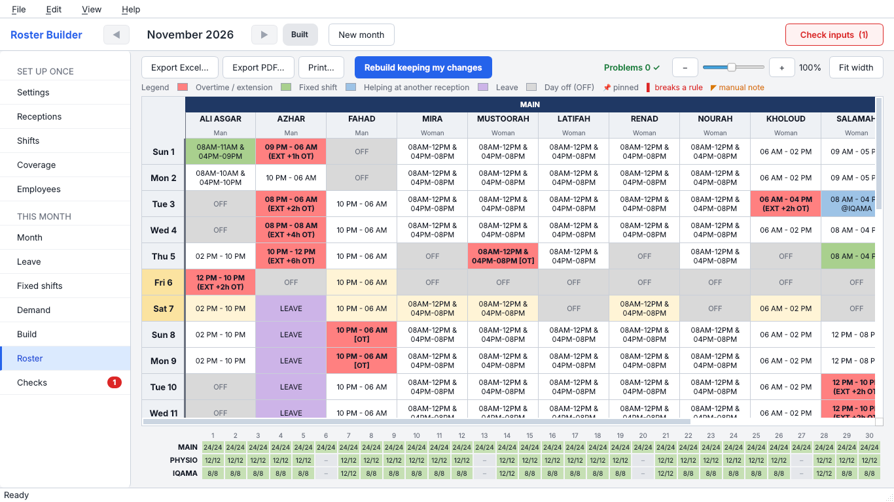

# Roster Builder

**Roster Builder** is a Windows desktop app that plans the monthly duty roster for 24/7 reception teams. You enter your staff, shifts and coverage needs once. Each month you add leave and fixed shifts and press **Build**. The app then makes a roster that keeps every rule and shows it in a colour-coded grid. You can change cells by hand, and the rules are re-checked straight away. The finished roster exports to PDF or Excel.

The app is **bilingual (English / العربية)**, with a full right-to-left Arabic layout. It works offline, and all data stays on the user's PC.

> **روستر بيلدر** برنامج لسطح المكتب يُعدّ جدول المناوبات الشهري لفرق الاستقبال التي تعمل على مدار الساعة. يدعم العربية والإنجليزية، ويعمل دون إنترنت، وتبقى بياناتك على جهازك. انظر [دليل التثبيت](docs/INSTALL.md) و[دليل المستخدم بالعربية](roster_builder/packaging/USER_GUIDE_AR.md).



## Documentation

| Document | What it covers |
|---|---|
| [docs/INSTALL.md](docs/INSTALL.md) | Downloading or building the installer, installing on another PC, moving data, uninstalling (English + Arabic) |
| [docs/WORKFLOW.md](docs/WORKFLOW.md) | First-time setup and the monthly routine, step by step (English + Arabic) |
| [docs/CAPABILITIES.md](docs/CAPABILITIES.md) | Everything the app can do, and the scheduling rules it enforces |
| [User guide (English)](roster_builder/packaging/USER_GUIDE.md) | Full illustrated manual, also shown in the app under **Help → User guide (F1)** |
| [دليل المستخدم (العربية)](roster_builder/packaging/USER_GUIDE_AR.md) | Full Arabic manual, shown in the app when the language is Arabic |

## Get the app

- **Ready-made installer:** open the **Releases** page, or the latest run of **Actions → Build Windows installer**. Download `RosterBuilder_Setup_<version>.exe` and run it. No administrator rights are needed.
- **Build it yourself on Windows:** double-click `roster_builder\packaging\build_exe.bat`. See [docs/INSTALL.md](docs/INSTALL.md).

## Repository layout

```
roster_builder/            the app (Python 3.11+, PySide6, OR-Tools CP-SAT)
  ui/                      the screens
  packaging/               build_exe.bat, RosterBuilder.spec (PyInstaller), RosterBuilder.iss (Inno Setup),
                           requirements.txt, user guides, icon, run_debug.bat, cleanup_project.bat
  screens/                 screenshots used by the guides
docs/                      install guide, workflow, capabilities
.github/workflows/         automatic Windows build of the installer
```

Run from source with `python -m roster_builder` after running `pip install -r roster_builder/packaging/requirements.txt`.
