# Roster Builder – User guide

Roster Builder plans your monthly duty roster for 24/7 reception teams. You enter your staff, shifts and coverage **once**. Each month you only change what is different (usually leave and fixed shifts), press **Build**, check the result, fix a few cells if you want, and export it to **PDF** or **Excel**.

Everything you type is saved automatically on this computer. There is no Save button. You do not need Excel, and nothing is sent over the internet.

---

## 1. Installing the program

Roster Builder comes as one setup file called `RosterBuilder_Setup_<version>.exe`.

1. Double-click the setup file. It installs for **your user only**, so no administrator rights are needed. Choose **English** or **العربية** for the setup window.
2. Keep the suggested folder (`%LOCALAPPDATA%\Programs\RosterBuilder`) and tick **Create a desktop shortcut** if you want one.
3. Press **Install**, then **Finish** (leave "Launch Roster Builder" ticked to start it at once). If Windows asks whether you trust the program, choose **More info → Run anyway**.
4. The program is in the Start menu under **Roster Builder**. To remove it, use **Settings → Apps** (or the Start-menu uninstall entry). **Your data is not deleted** when you uninstall: it stays in `%APPDATA%\RosterBuilder`, so a later re-install finds everything again.

To update, run the newer setup file: it installs over the old version and keeps your data.

If you only got the folder `RosterBuilder` (no setup file), copy it anywhere (for example `C:\RosterBuilder`) and double-click `RosterBuilder.exe`.

---

## 2. The first start

The first time you open the program you see the welcome screen.

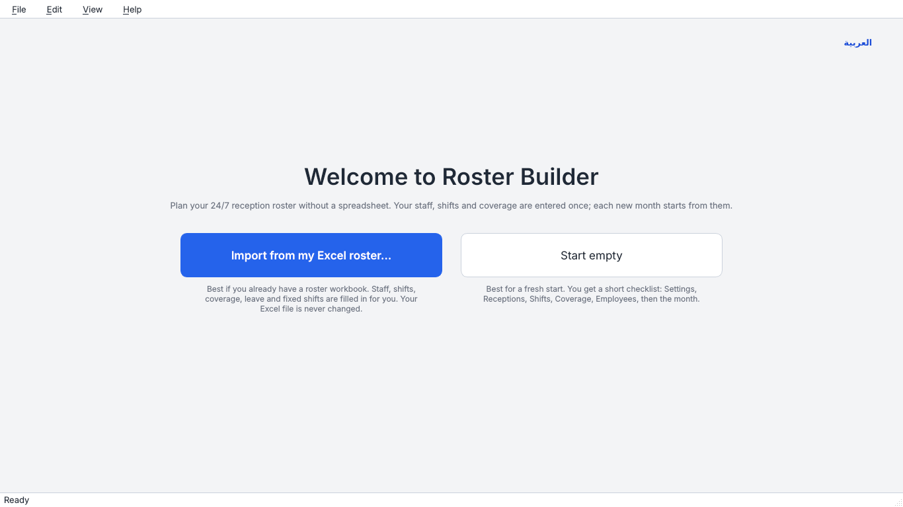

* **Import from my Excel roster…** – best if you already have the old roster workbook. Staff, shifts, coverage, leave and fixed shifts are filled in for you. Your Excel file is never changed. The program shows a short report of what it imported and what it skipped.
* **Start empty** – best for a fresh start. A short checklist guides you through the setup in the right order (section 3).

You only do this once. Afterwards the program opens straight on your data.

---

## 3. Setting up (do this once)

The left side of the window lists the setup screens in the order to fill them in:

| Order | Screen | What you enter |
|---|---|---|
| 1 | **Settings** | Week start, longest shift, hours per week, minimum rest between shifts, men-only hours, days off per week, weekend days, overtime rules. |
| 2 | **Receptions** | The names of your receptions (desks). |
| 3 | **Shifts** | The shifts people can work, as start and end times (a second part makes a split shift). The shift name is made from the times. |
| 4 | **Coverage** | For each reception, which hours need at least how many people (and how many men), and the maximum. The coloured bars show gaps. |
| 5 | **Employees** | Each person: gender, home reception, who they can also help, fixed days off, allowed shifts, hours per week, overtime allowed and **overtime priority**. |

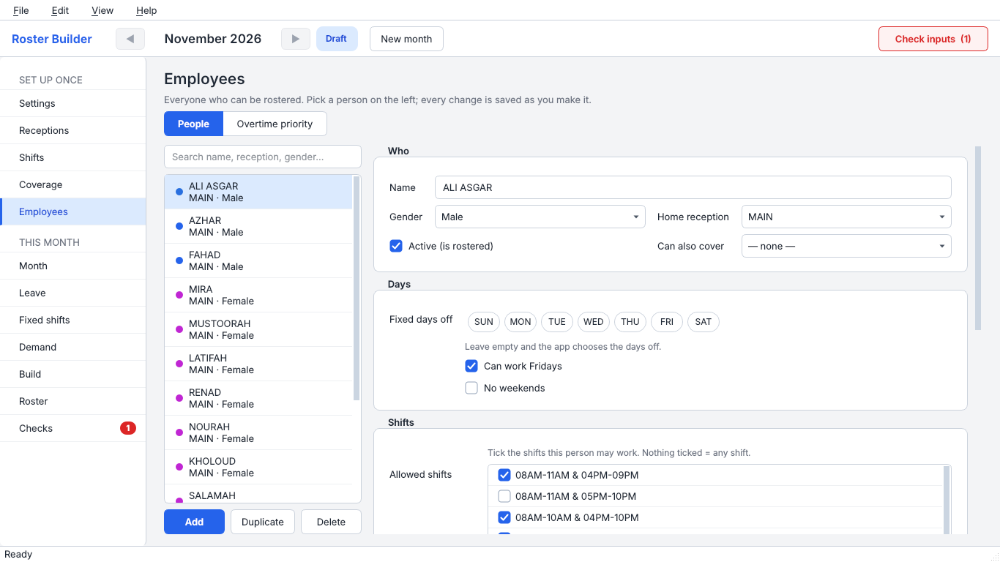

Fields with a problem get a red border and a message when you point at them (for example "end before start" or two fixed days off that are not next to each other). Fix them before building.

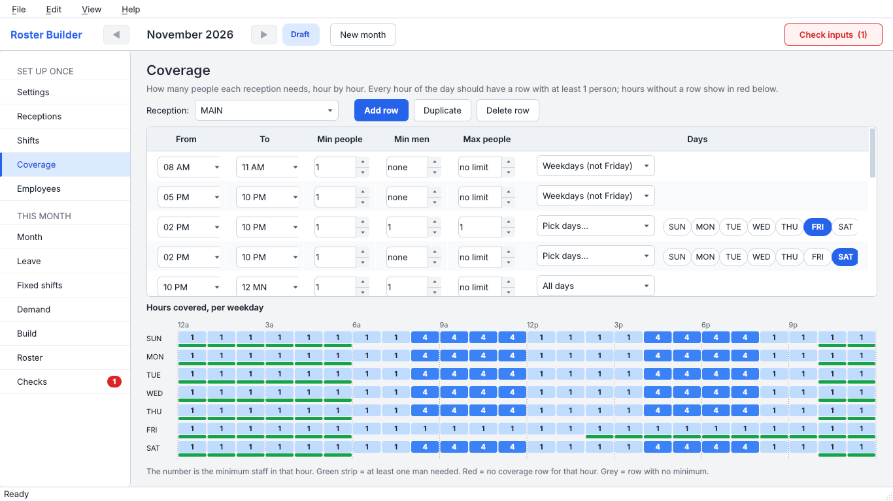

You can undo with **Ctrl+Z** and redo with **Ctrl+Y** on every screen.

---

## 4. Every month

### Step 1 – New month

Press **New month** at the top. The new month starts as a copy of the previous one: same staff, shifts and coverage. Leave that overlaps the new month is carried over, and you may copy the fixed shifts too. Old months stay exactly as they were.

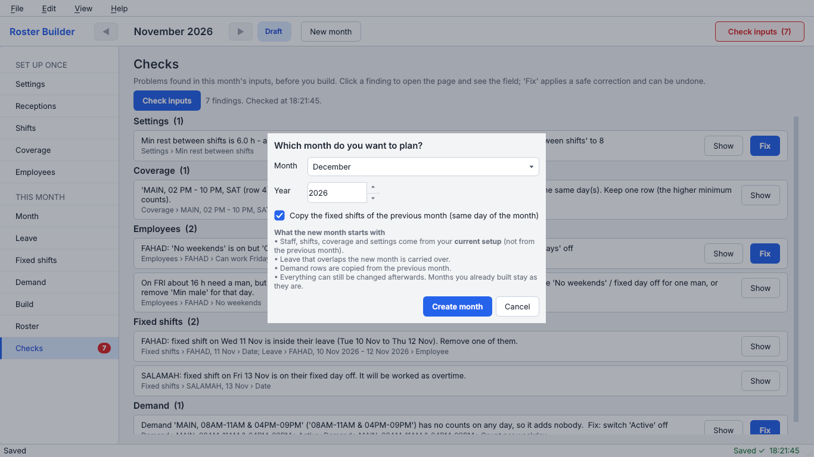

### Step 2 – Leave and fixed shifts

Under **THIS MONTH** on the left:

* **Leave** – who is away and when (pick the dates in the calendar).
* **Fixed shifts** – a shift that must be placed exactly as entered (for example a training day).
* **Demand** (optional, advanced) – asks for a number of people on a given shift in addition to the coverage hours.

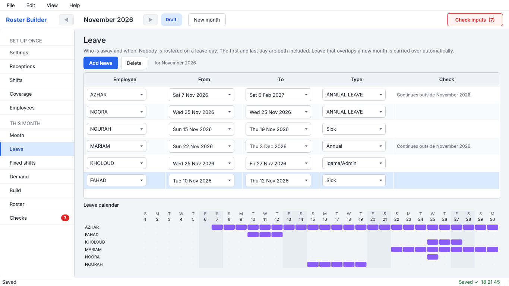

### Step 3 – Check inputs

Press **Check inputs** (top right) or open **Checks**. It lists mistakes in your entries, grouped by screen. Click a line and the program jumps to the exact field and marks it. Some lines have a **Fix** button – nothing is changed until you press it.

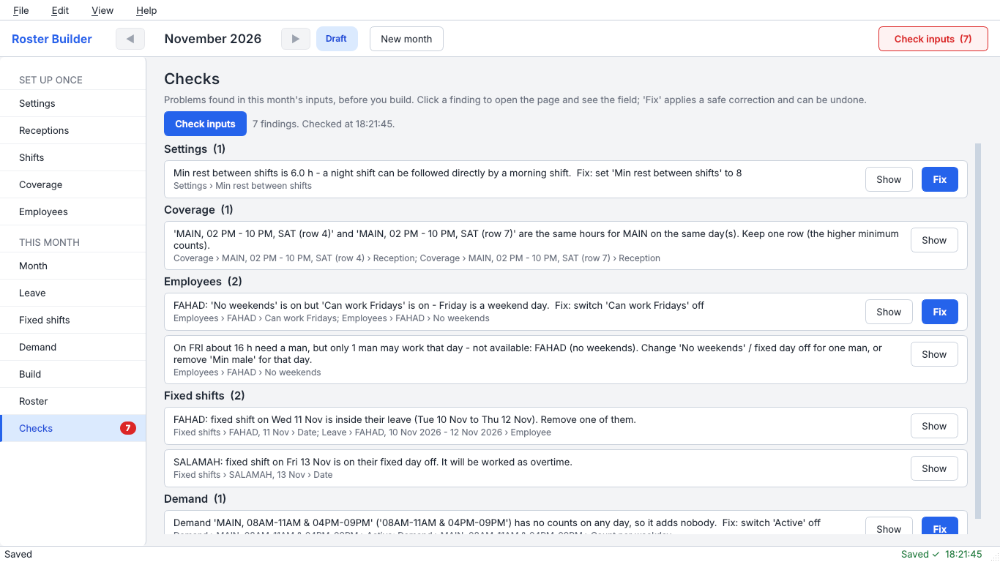

You can still build with open findings, but the best roster comes from clean inputs.

### Step 4 – Build

Open **Build** and press the big button. The roster is made in the background; you see the elapsed time and can cancel. The **time limit** is 60 seconds by default: the program stops searching after that and keeps the best roster it found (usually it finishes sooner). For a very tight month you can raise it.

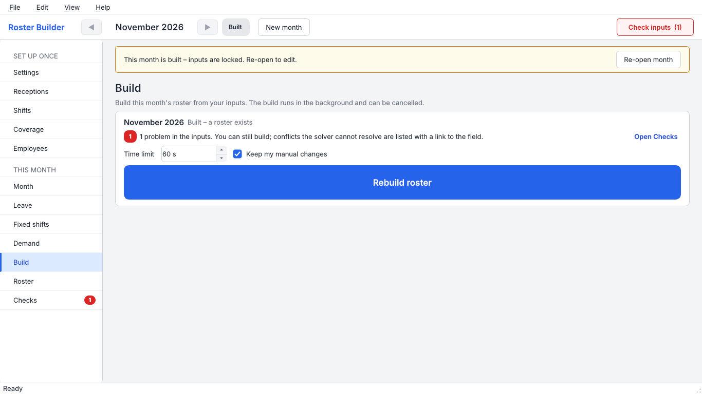

When it is done you see how many shifts and overtime hours the roster has, and whether any rule check needs attention. If no roster is possible, you get a list of the conflicting entries with links to the fields – never just "impossible".

### Step 5 – Review the roster

Open **Roster**. Days are rows, employees are columns, grouped under their reception. The strip under the grid shows for each reception and day how many of the needed hours are covered (for example 24/24).

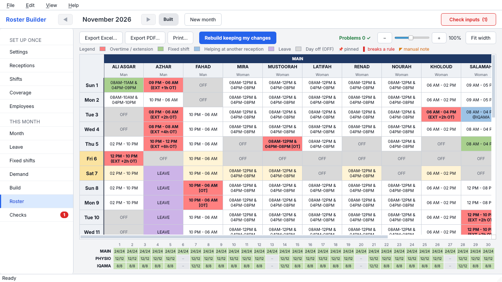

**Problems 0 ✓** at the top right means every rule is kept. When something breaks a rule, the list opens on the right and the cell gets a red corner.

### Step 6 – Change cells and rebuild keeping your changes

Double-click a cell to change it: another shift, OFF, another reception, **Work as overtime**, or start earlier / finish later.

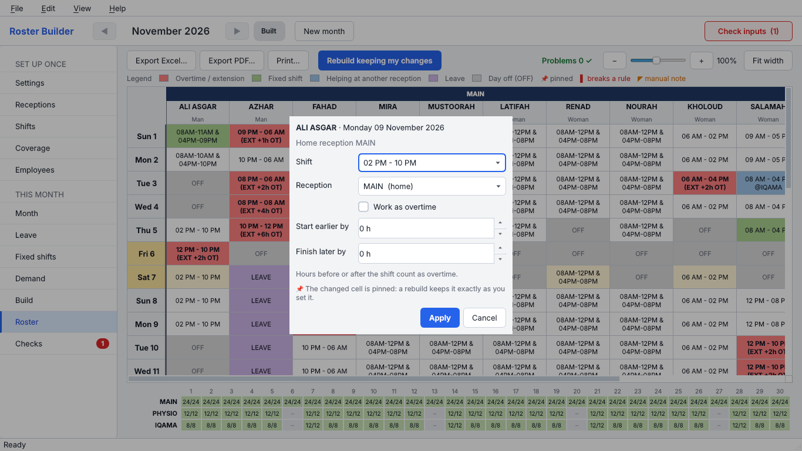

* Every change is **pinned** (small pin in the cell). The rules are checked again at once.
* **Rebuild keeping my changes** makes the roster again and keeps every pinned cell exactly as you set it. The rest is planned around them.
* Right-click a cell to unpin it or go back to the built value. Ctrl+Z undoes your last change.

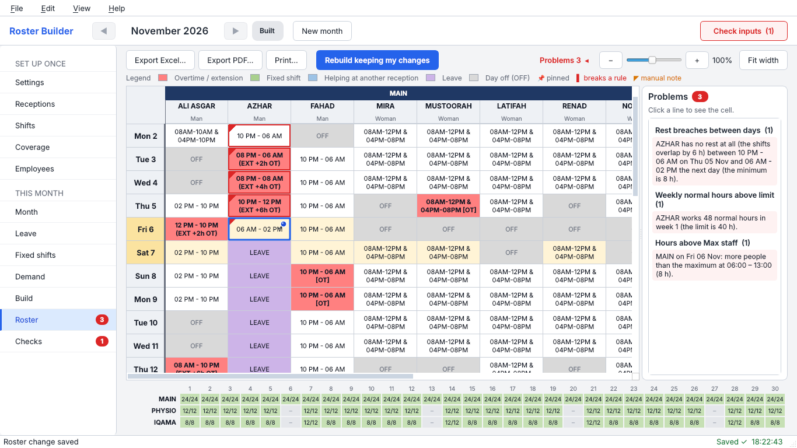

Two kinds of manual changes are **not** errors, they are shown as notes so you do not lose sight of them:

* **Overtime on a normal working day** – you ticked "work as overtime" for a day that is not a planned day off. The cell gets an **orange** corner and the list shows a warning "Overtime on a normal working day – manual". The program itself only plans overtime on days off or as extension hours.
* **Extra day off (manual)** – you set a cell to OFF on a day that is not a planned day off. It gets a **blue** corner and an information line. Check that the days around it are still covered.

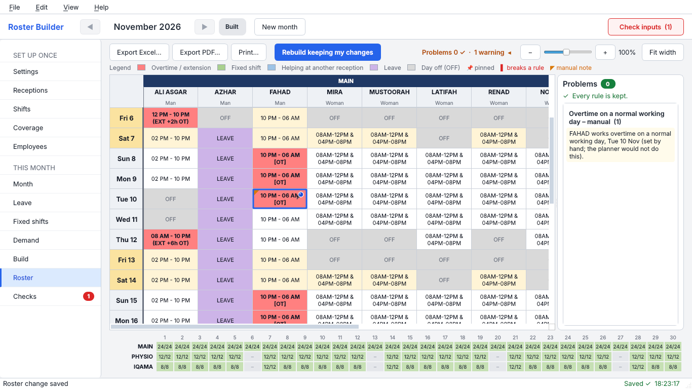

### Step 7 – Export

On the Roster screen: **Export Excel…**, **Export PDF…** or **Print…**. The exports include your manual changes. The Excel file also holds the rule checks, weekly hours and coverage tables.

---

## 5. Overtime priority – how it works

On the Employees screen you can give people who are allowed to work overtime a **priority from 1 to 10** (1 = first choice). Several people may share a rank. Leave it empty for no priority.

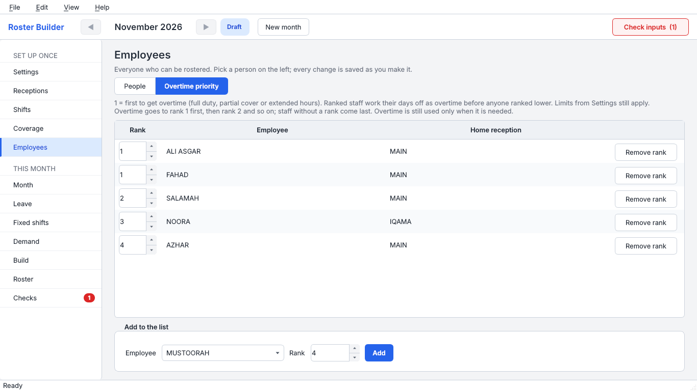

The rules, in plain words:

* **Strict order.** Overtime that is needed goes to the highest-ranked person who can legally take it. Rank 2 gets overtime only where no rank-1 person can. Then rank 3, and so on. People without a rank come last, after every ranked person has been used up.
* **Days off are worked first.** A ranked person's planned day off is worked as overtime *before* a lower-ranked or unranked person gets any overtime. The day-off pattern itself never moves; the day is just worked as overtime.
* **The settings limits still apply.** The overtime limit per week, the longest extension, and "keep one free day per week" (when it is on) are never broken for the sake of a rank.
* **A rank only helps where the person's allowed shifts fit.** Rank 1 cannot take a shift that is not in their allowed shifts, or one that breaks rest rules, leave, the men-only hours or the reception rules. Then the next rank gets it.
* **Overtime is only used when needed.** A spare colleague without overtime is always used first.
* Only people with **Overtime allowed** switched on can be ranked.

After a build, the Build page and the Checks list the overtime hours per rank and tell you whether the priority was respected.

---

## 6. What the colours mean

| Colour | Meaning |
|---|---|
| Red / salmon (bold text) | Overtime or an extended shift |
| Green | Fixed shift |
| Blue | Helping at another reception |
| Purple | Leave |
| Grey "OFF" | Day off |
| Light yellow row | Weekend day (Friday and Saturday by default; set in Settings) |
| White | Normal shift |
| Pin symbol | You changed this cell by hand; a rebuild keeps it |
| Red corner and border | A rule is broken here (point at the cell to read why) |
| Orange corner | Manual overtime on a normal working day (warning) |
| Blue corner | Extra day off set by hand (information) |

---

## 7. Backups, restoring and moving to another PC

* A **backup is made every time the program starts**, and the last 10 are kept.
* **File → Backup now** makes one at once. Do this before big changes.
* **File → Restore…** lets you pick a backup. The current data is backed up first, then replaced.
* Your data folder is `%APPDATA%\RosterBuilder` (type this in the Explorer address bar). **Help → About** has a button that opens it. The database is `roster.db`; backups are in the `backups` folder.
* **Moving to another PC:** on the old PC choose **File → Backup now** and copy the newest file from the `backups` folder (for example with a USB stick). Install Roster Builder on the other PC, open it, choose **File → Restore…** and pick that file. Your staff, shifts, coverage and all months appear exactly as they were. In short: copy your backup file to the other PC and use Restore.

---

## 8. Language: English / العربية

Choose **View → Language → English / العربية** (the welcome screen has the same switch). The whole program changes **at once**: the window is rebuilt in the other language, the layout is mirrored for Arabic (right to left), and you stay on the same screen and month. Nothing is lost and you never need to close the program. The choice is remembered for the next start.

* Names, notes and leave types you type can be in Arabic or English, in any screen, and search works with both.
* **Exports (PDF and Excel) are always in English**; Arabic names inside them are shown correctly.
* An Arabic version of this guide is shown under **Help → User guide** when the language is Arabic.

---

## 9. Help menu

* **User guide** (F1) – this guide.
* **About** – version, where your data and the log file are, with buttons to open the folders.

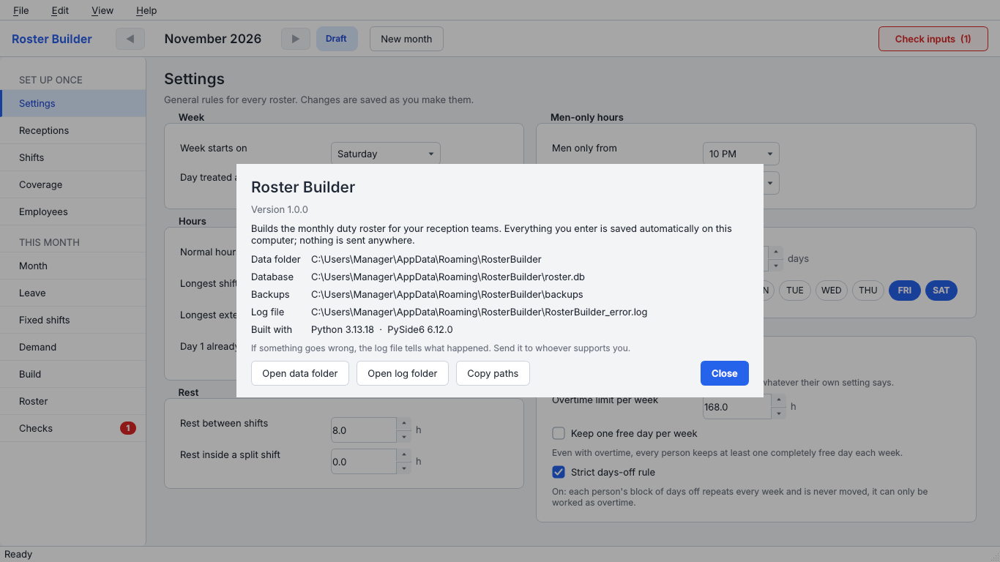

---

## 10. If something goes wrong

* The program never shows raw error text. If it cannot start, or crashes, it writes the details to the **log file** `RosterBuilder_error.log` in your data folder (`%APPDATA%\RosterBuilder`). **Help → About** shows the exact place.
* Send that file to your support person.
* Nothing opens at all? Run `roster_builder\packaging\run_debug.bat` in the project folder (needs the project folder and Python). It starts the program with extra diagnostics and saves everything to `run_debug.log` next to it.
* "Windows protected your PC" – choose **More info → Run anyway**. The program is not signed.
* A build takes the full 60 seconds and the result is not perfect – that is normal for a tight month; raise the time limit on the Build page or relax a setting named in the conflict list.
* Your data is safe: close the program, then use **File → Restore…** after reopening, or copy a file from the `backups` folder over `roster.db`.

---

## 11. Quick reference

| I want to… | Do this |
|---|---|
| Plan next month | New month → Leave / Fixed shifts → Check inputs → Build → Roster |
| Give someone a day off in the roster | Roster → double-click the cell → OFF |
| Make someone work overtime on a day | Roster → double-click the cell → tick "Work as overtime" |
| Keep my edits and build again | Roster → Rebuild keeping my changes |
| Get a PDF | Roster → Export PDF… |
| Undo | Ctrl+Z |
| Find my data | Help → About → Open data folder |
| Switch to Arabic | View → Language → العربية |
| Copy my data to another PC | File → Backup now, copy the file, then File → Restore… on the other PC |

---

## 12. For the person who builds the program (Windows)

1. Install **Python 3.14** from python.org (tick "Add python.exe to PATH").
2. Put the project folder (it contains `roster_builder\`) anywhere, for example `C:\roster`.
3. Double-click `roster_builder\packaging\build_exe.bat`. It makes a `.venv` folder, installs the requirements and PyInstaller, and builds. The first run downloads about 400 MB.
4. It then looks for **Inno Setup 6** (and installs it with winget if it is missing; otherwise download it from https://jrsoftware.org/isdl.php) and makes the setup file `dist\installer\RosterBuilder_Setup_<version>.exe`. Give that one file to the manager. The program folder `dist\RosterBuilder\` also works on its own.
5. To check a build quickly: open a Command Prompt in `dist\RosterBuilder` and run `RosterBuilder.exe --smoke-test`. It prints nothing on screen; look at the exit code with `echo %errorlevel%` (0 = fine) – or simply start the program normally.
