# منشئ جداول المناوبات – دليل المستخدم

يعدّ «منشئ جداول المناوبات» (Roster Builder) جدول المناوبات الشهري لفرق الاستقبال العاملة على مدار الساعة. تُدخل الموظفين والمناوبات والتغطية **مرة واحدة**، ثم تغيّر كل شهر ما يختلف فقط (عادةً الإجازات والمناوبات الثابتة)، وتضغط **الإنشاء**، وتراجع النتيجة، وتعدّل بضع خانات إن شئت، ثم تصدّر الجدول إلى **PDF** أو **إكسل**.

كل ما تكتبه يُحفظ تلقائيًا على هذا الحاسوب. لا يوجد زر «حفظ». لا تحتاج إلى إكسل، ولا يُرسَل شيء عبر الإنترنت.

> لقطات الشاشة في هذا الدليل بعضها بالعربية وبعضها بالإنجليزية؛ المحتوى والأزرار هي نفسها في اللغتين.

---

## 1. تثبيت البرنامج

يصلك البرنامج كملف تثبيت واحد باسم `RosterBuilder_Setup_<الإصدار>.exe`.

1. انقر مرتين على ملف التثبيت. يُثبَّت البرنامج **لمستخدمك أنت فقط**، فلا تحتاج إلى صلاحيات المسؤول. اختر **English** أو **العربية** للغة نافذة التثبيت.
2. اترك المجلد المقترح (`%LOCALAPPDATA%\Programs\RosterBuilder`)، وحدّد **إنشاء اختصار على سطح المكتب** إن رغبت.
3. اضغط **تثبيت** ثم **إنهاء** (اترك خيار «تشغيل Roster Builder» محددًا ليبدأ البرنامج فورًا). إذا سألك ويندوز هل تثق بالبرنامج فاختر **مزيد من المعلومات ← تشغيل على أي حال**.
4. تجد البرنامج في قائمة «ابدأ» تحت **Roster Builder**. لإزالته استخدم **الإعدادات ← التطبيقات** (أو إدخال إلغاء التثبيت في قائمة «ابدأ»). **لا تُحذف بياناتك عند إلغاء التثبيت**: تبقى في المجلد `%APPDATA%\RosterBuilder`، فإذا أعدت التثبيت لاحقًا وجدت كل شيء كما تركته.

للتحديث شغّل ملف التثبيت الأحدث: يُثبَّت فوق الإصدار القديم ويحتفظ ببياناتك.

إذا وصلك المجلد `RosterBuilder` فقط (دون ملف تثبيت) فانسخه إلى أي مكان (مثل `C:\RosterBuilder`) وانقر مرتين على `RosterBuilder.exe`.

---

## 2. أول تشغيل

عند فتح البرنامج لأول مرة تظهر شاشة الترحيب. في أعلاها مفتاح تبديل اللغة (English / العربية).

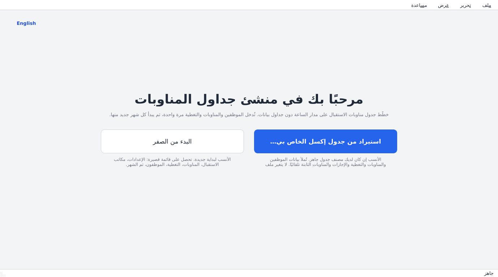

* **استيراد من جدول إكسل الخاص بي…** – الأنسب إذا كان لديك مصنّف الجدول القديم. تُملأ بيانات الموظفين والمناوبات والتغطية والإجازات والمناوبات الثابتة تلقائيًا. لا يتغيّر ملف إكسل الأصلي أبدًا. ويعرض البرنامج تقريرًا قصيرًا بما استورده وما تخطّاه.
* **البدء من الصفر** – الأنسب للبداية الجديدة. تقودك قائمة قصيرة خلال الإعداد بالترتيب الصحيح (القسم 3).

تفعل هذا مرة واحدة فقط. بعدها يفتح البرنامج مباشرة على بياناتك.

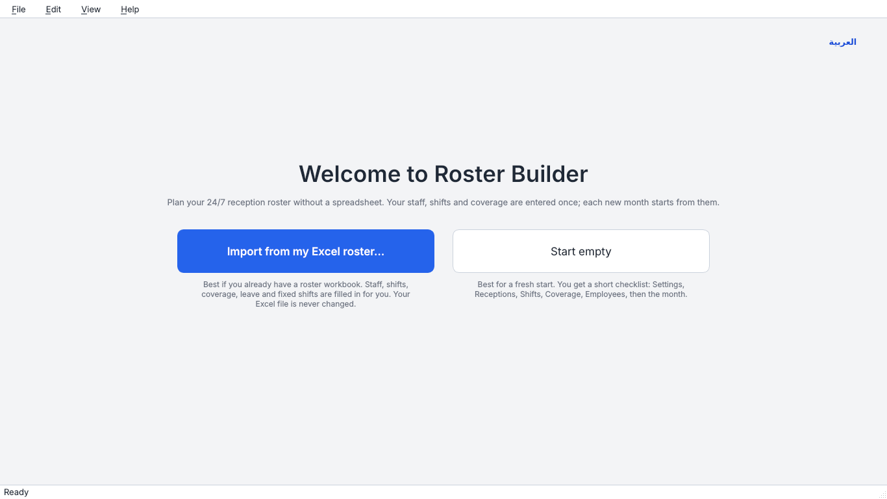

---

## 3. الإعداد (مرة واحدة)

تسرد الجهة الجانبية من النافذة شاشات الإعداد بالترتيب الذي تُملأ به:

| الترتيب | الشاشة | ما تُدخله |
|---|---|---|
| 1 | **الإعدادات** | بداية الأسبوع، أطول مناوبة، الساعات في الأسبوع، الحد الأدنى للراحة بين المناوبات، ساعات الرجال فقط، أيام الراحة في الأسبوع، أيام عطلة نهاية الأسبوع، قواعد العمل الإضافي. |
| 2 | **مكاتب الاستقبال** | أسماء مكاتب الاستقبال. |
| 3 | **المناوبات** | المناوبات التي يعمل بها الموظفون، بوقت البداية والنهاية (جزء ثانٍ يصنع مناوبة مجزّأة). يُشتق اسم المناوبة من الأوقات. |
| 4 | **التغطية** | لكل مكتب استقبال: أي الساعات تحتاج إلى عدد أدنى من الأشخاص (وكم منهم رجال) والحد الأقصى. تُظهر الأشرطة الملونة الثغرات. |
| 5 | **الموظفون** | لكل شخص: الجنس، الاستقبال الأساسي، من يستطيع مساعدتهم أيضًا، أيام الراحة الثابتة، المناوبات المسموحة، الساعات في الأسبوع، السماح بالعمل الإضافي و**أولوية العمل الإضافي**. |

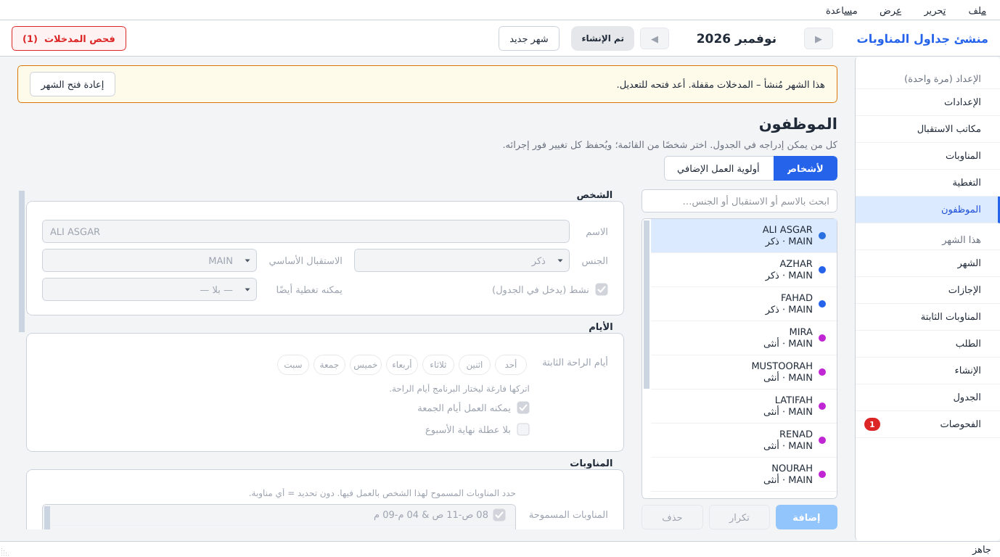

تظهر على الحقل الذي فيه مشكلة حدود حمراء ورسالة عند الإشارة إليه (مثل «النهاية قبل البداية» أو يومَي راحة ثابتين غير متجاورين). أصلحها قبل الإنشاء.

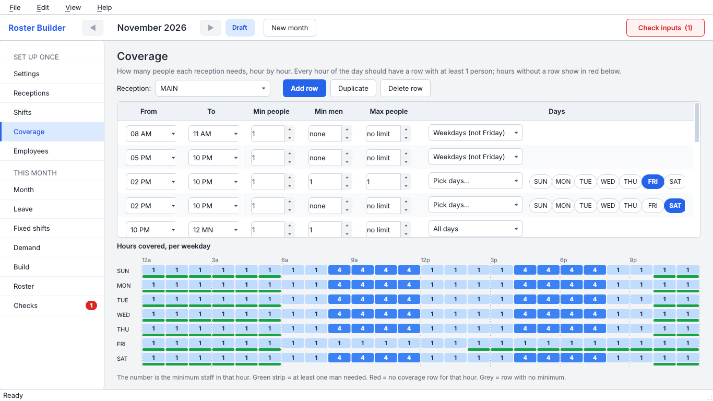

يمكنك التراجع بـ **Ctrl+Z** والإعادة بـ **Ctrl+Y** في كل شاشة.

---

## 4. كل شهر

### الخطوة 1 – شهر جديد

اضغط **شهر جديد** في الأعلى. يبدأ الشهر الجديد نسخةً من الشهر السابق: الموظفون والمناوبات والتغطية نفسها. تُنقل الإجازات التي تتداخل مع الشهر الجديد، ويمكنك نسخ المناوبات الثابتة أيضًا. تبقى الأشهر القديمة كما كانت تمامًا.

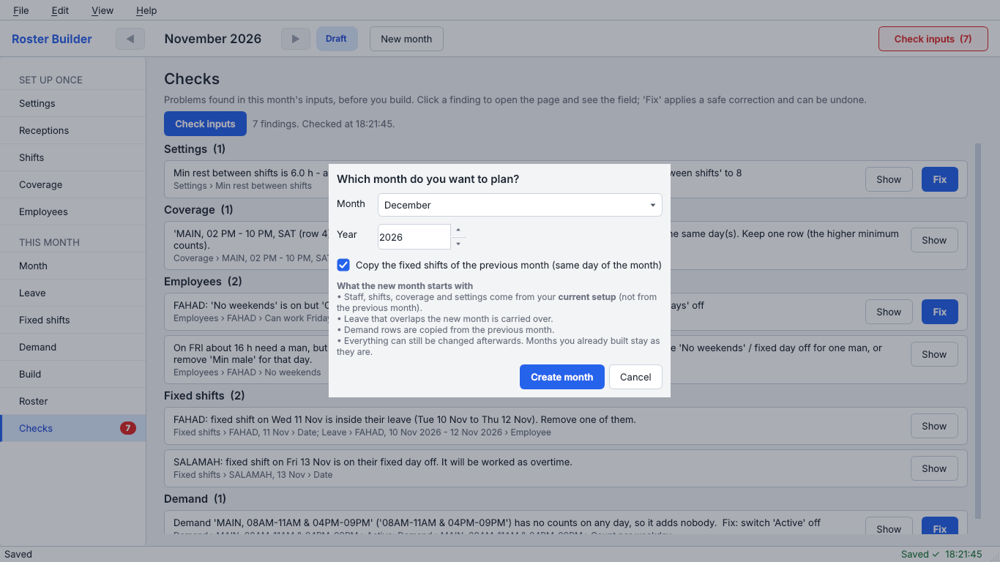

### الخطوة 2 – الإجازات والمناوبات الثابتة

تحت **هذا الشهر** في الجانب:

* **الإجازات** – من غائب ومتى (اختر التواريخ من التقويم).
* **المناوبات الثابتة** – مناوبة يجب وضعها تمامًا كما أُدخلت (مثل يوم تدريب).
* **الطلب** (اختياري ومتقدم) – يطلب عددًا من الأشخاص في مناوبة معيّنة إضافةً إلى ساعات التغطية.

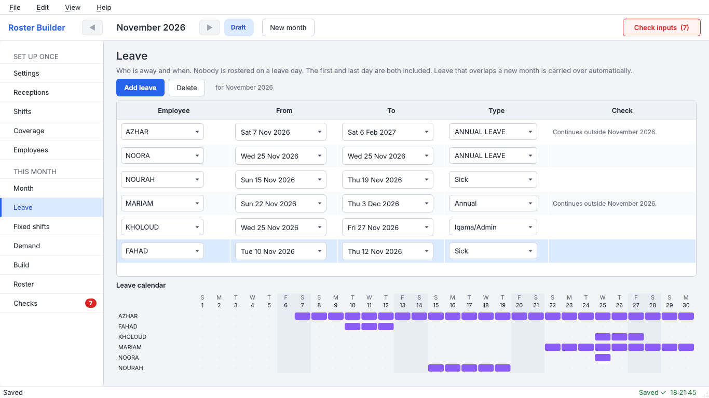

### الخطوة 3 – فحص المدخلات

اضغط **فحص المدخلات** (أعلى اليسار) أو افتح **الفحوصات**. تُسرد فيها أخطاء مدخلاتك مجمّعة حسب الشاشة. انقر سطرًا فينتقل البرنامج إلى الحقل المعني ويظلّله. بعض الأسطر فيها زر **إصلاح** – لا يتغيّر شيء حتى تضغطه.

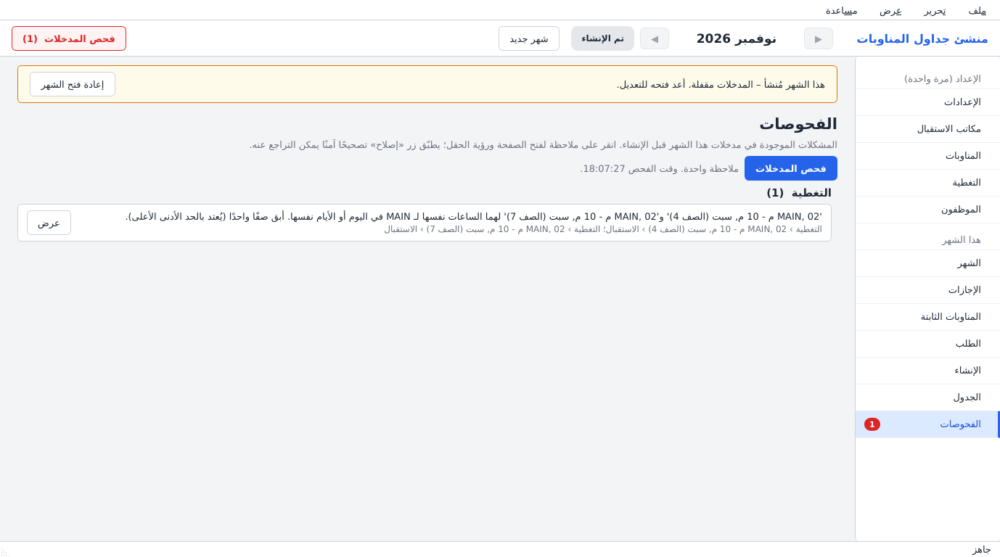

يمكنك الإنشاء مع بقاء ملاحظات مفتوحة، لكن أفضل جدول يأتي من مدخلات سليمة.

### الخطوة 4 – الإنشاء

افتح **الإنشاء** واضغط الزر الكبير. يُعدّ الجدول في الخلفية؛ ترى الوقت المنقضي ويمكنك الإلغاء. **المهلة الزمنية** 60 ثانية افتراضيًا: يتوقف البحث بعدها ويحتفظ بأفضل جدول وجده (وغالبًا ينتهي قبلها). في الأشهر الضيقة جدًا يمكنك رفعها.

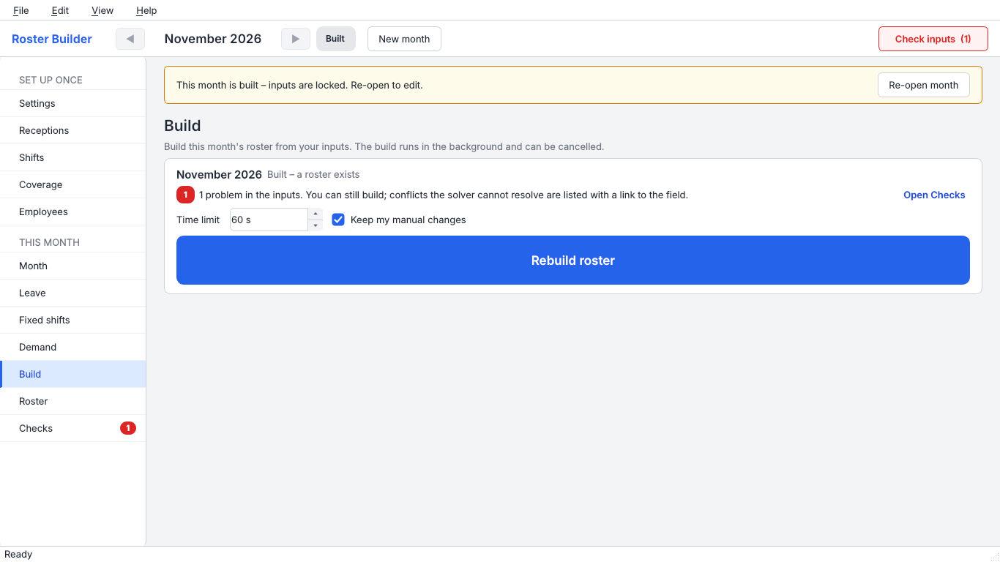

عند الانتهاء ترى عدد المناوبات وساعات العمل الإضافي، وهل تحتاج أي قاعدة إلى انتباه. وإن تعذّر إعداد جدول فستحصل على قائمة بالمدخلات المتعارضة مع روابط إلى الحقول – وليس عبارة «مستحيل» وحدها.

### الخطوة 5 – مراجعة الجدول

افتح **الجدول**. الأيام صفوف والموظفون أعمدة، مجمّعون تحت مكتب استقبالهم. يُظهر الشريط تحت الشبكة لكل مكتب ويوم عدد الساعات المطلوبة المغطّاة (مثل 24/24).

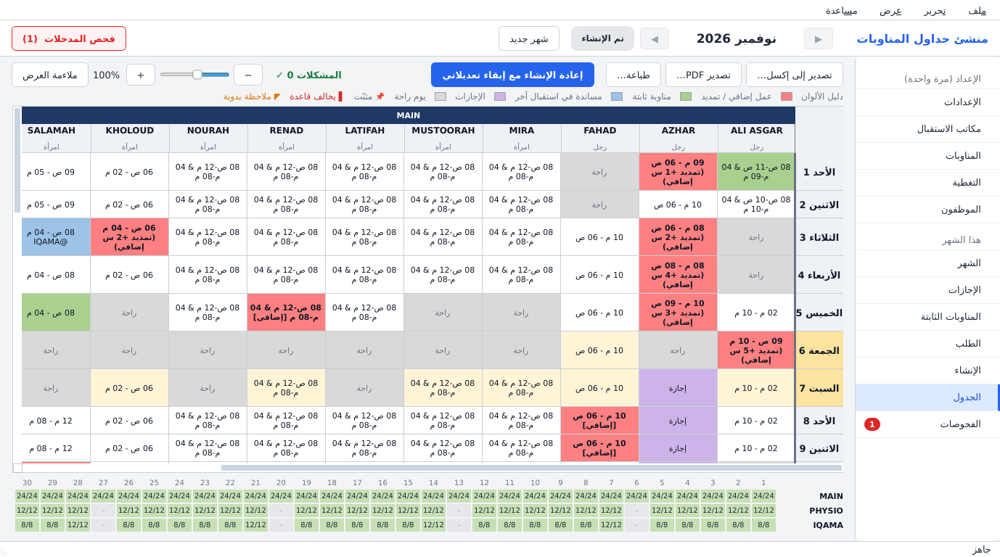

**المشكلات 0 ✓** في أعلى الجدول تعني أن كل القواعد محترمة. وحين تُخالَف قاعدة تفتح القائمة في الجانب وتظهر زاوية حمراء في الخانة.

### الخطوة 6 – تعديل الخانات وإعادة الإنشاء مع إبقاء تعديلاتك

انقر الخانة مرتين لتغييرها: مناوبة أخرى، أو راحة (OFF)، أو استقبال آخر، أو **العمل كعمل إضافي**، أو البدء أبكر / الانتهاء أبعد.

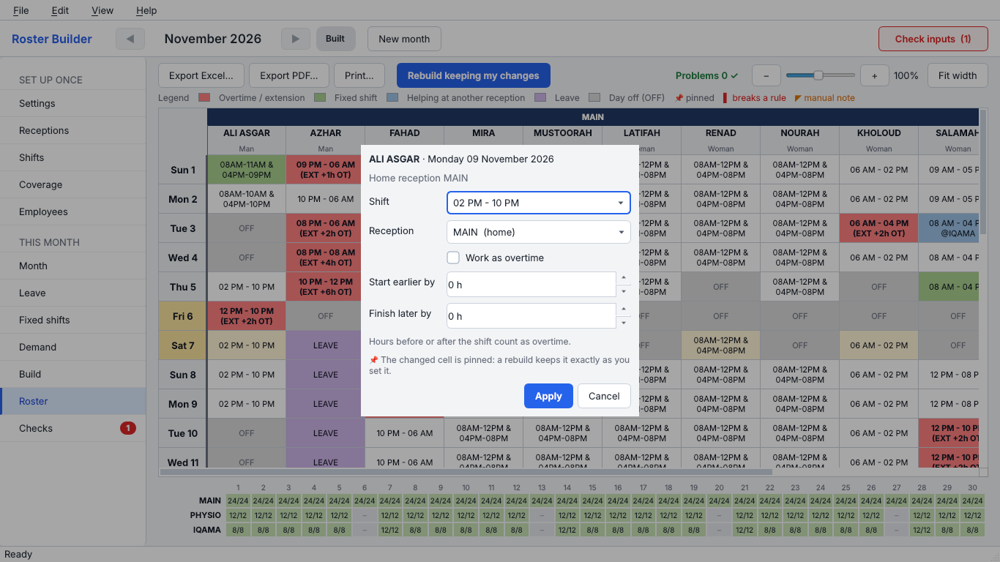

* كل تغيير **يُثبَّت** (دبوس صغير في الخانة) وتُفحص القواعد من جديد فورًا.
* **إعادة الإنشاء مع إبقاء تعديلاتي** يعيد إعداد الجدول ويُبقي كل خانة مثبّتة كما ضبطتها، ويُخطَّط الباقي حولها.
* انقر بزر الفأرة الأيمن على خانة لإلغاء تثبيتها أو العودة إلى القيمة المُنشأة. و Ctrl+Z يتراجع عن آخر تغيير.

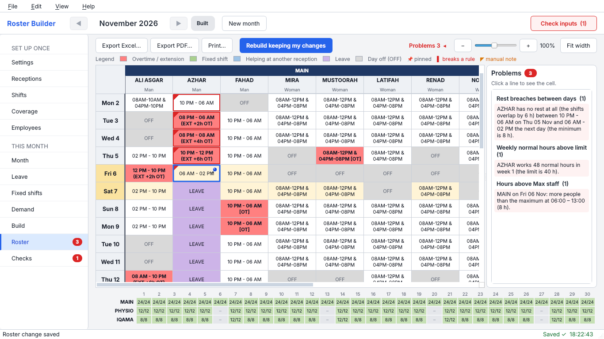

نوعان من التعديلات اليدوية **ليسا أخطاء**، بل يظهران كملاحظات كي لا تغيب عن نظرك:

* **عمل إضافي في يوم عمل عادي** – وضعت علامة «العمل كعمل إضافي» في يوم ليس يوم راحة مخطَّطًا. تظهر في الخانة زاوية **برتقالية** وفي القائمة تحذير. أما البرنامج نفسه فلا يخطّط العمل الإضافي إلا في أيام الراحة أو كساعات تمديد.
* **يوم راحة إضافي (يدوي)** – جعلت الخانة راحة في يوم ليس يوم راحة مخطَّطًا. تظهر زاوية **زرقاء** وسطر معلومات. تحقق أن الأيام المجاورة ما زالت مغطّاة.

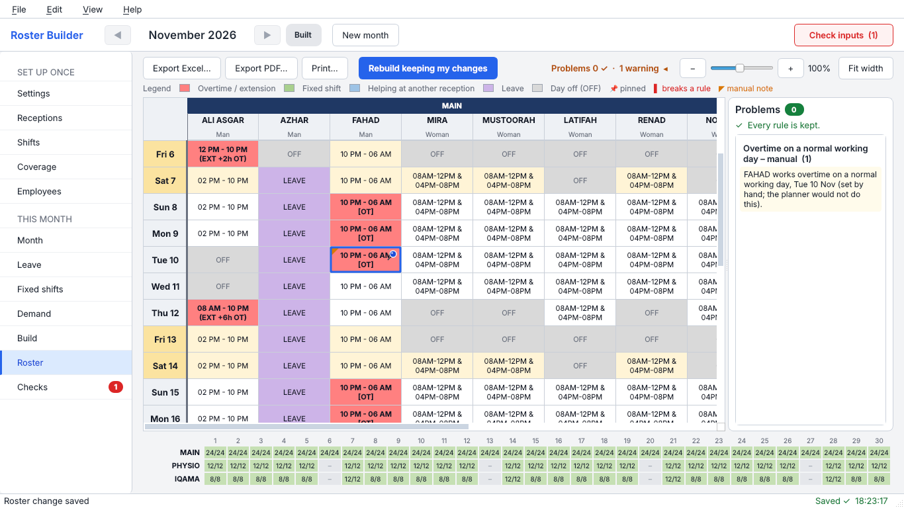

### الخطوة 7 – التصدير

في شاشة الجدول: **تصدير إلى إكسل…** أو **تصدير PDF…** أو **طباعة…**. تشمل الملفات المصدَّرة تعديلاتك اليدوية، ويحوي ملف إكسل كذلك جداول فحص القواعد والساعات الأسبوعية والتغطية. **ملفات التصدير تكون دائمًا بالإنجليزية**، أما الأسماء العربية داخلها فتظهر بشكل صحيح.

---

## 5. أولوية العمل الإضافي – كيف تعمل

في شاشة الموظفين يمكنك إعطاء من يُسمح لهم بالعمل الإضافي **أولوية من 1 إلى 10** (1 = الخيار الأول). يجوز أن يشترك عدة أشخاص في الرتبة نفسها. اتركها فارغة لعدم وجود أولوية.

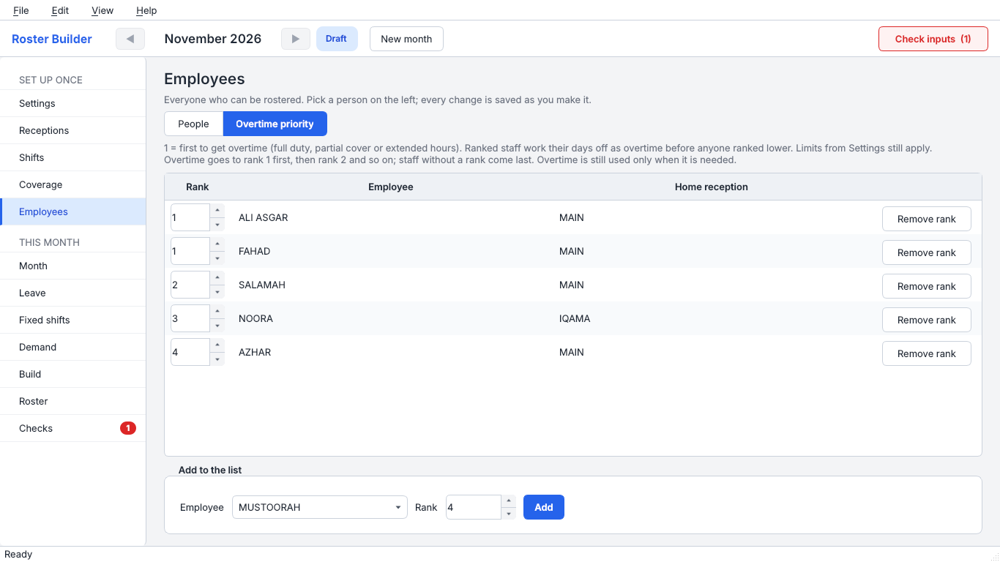

القواعد بكلمات بسيطة:

* **ترتيب صارم.** يذهب العمل الإضافي المطلوب إلى أعلى شخص رتبةً يستطيع أخذه نظاميًا. الرتبة 2 لا تحصل عليه إلا حيث لا يستطيع أحد من الرتبة 1، ثم الرتبة 3، وهكذا. ومن بلا رتبة يأتي أخيرًا، بعد استنفاد كل أصحاب الرتب.
* **تُعمَل أيام الراحة أولًا.** يوم الراحة المخطَّط لصاحب رتبة يُعمل كعمل إضافي *قبل* أن ينال أي شخص أدنى رتبةً أو بلا رتبة أي عمل إضافي. نمط أيام الراحة نفسه لا يتحرك أبدًا؛ يُعمَل اليوم فقط كعمل إضافي.
* **حدود الإعدادات تبقى سارية.** لا يُكسر حد العمل الإضافي في الأسبوع ولا أطول تمديد ولا «يوم حر واحد في الأسبوع» (إذا كان مفعّلًا) من أجل رتبة.
* **الرتبة تفيد فقط حيث تناسب مناوباتُ الشخص المسموحة.** لا تستطيع الرتبة 1 أخذ مناوبة ليست ضمن مناوباتها المسموحة، أو تخالف قواعد الراحة أو الإجازة أو ساعات الرجال فقط أو قواعد الاستقبال. حينها تنالها الرتبة التالية.
* **لا يُستخدم العمل الإضافي إلا عند الحاجة.** يُستخدم دائمًا أولًا زميل متاح لا يحتاج إلى عمل إضافي.
* لا يُرتَّب إلا من فُعِّل لديهم **السماح بالعمل الإضافي**.

بعد الإنشاء تعرض صفحة الإنشاء والفحوصات ساعات العمل الإضافي لكل رتبة وتخبرك هل احتُرمت الأولوية.

---

## 6. معنى الألوان

| اللون | المعنى |
|---|---|
| أحمر / سلموني (نص عريض) | عمل إضافي أو مناوبة ممدَّدة |
| أخضر | مناوبة ثابتة |
| أزرق | مساعدة في استقبال آخر |
| بنفسجي | إجازة |
| «OFF» رمادي | يوم راحة |
| صف أصفر فاتح | يوم عطلة نهاية الأسبوع (الجمعة والسبت افتراضيًا؛ يُضبط في الإعدادات) |
| أبيض | مناوبة عادية |
| رمز الدبوس | غيّرت هذه الخانة يدويًا؛ وإعادة الإنشاء تُبقيها |
| زاوية وحدود حمراء | مخالفة قاعدة هنا (أشِر إلى الخانة لقراءة السبب) |
| زاوية برتقالية | عمل إضافي يدوي في يوم عمل عادي (تحذير) |
| زاوية زرقاء | يوم راحة إضافي ضُبط يدويًا (معلومة) |

---

## 7. النسخ الاحتياطي والاستعادة والانتقال إلى حاسوب آخر

* **تُؤخذ نسخة احتياطية في كل مرة يبدأ فيها البرنامج**، وتُحفظ آخر 10 نسخ.
* **ملف ← نسخة احتياطية الآن** يأخذ نسخة فورًا. افعل ذلك قبل التغييرات الكبيرة.
* **ملف ← استعادة…** يتيح لك اختيار نسخة احتياطية. تُؤخذ نسخة من البيانات الحالية أولًا ثم تُستبدل.
* مجلد بياناتك هو `%APPDATA%\RosterBuilder` (اكتبه في شريط عنوان المستكشف). في **مساعدة ← حول** زر يفتحه. قاعدة البيانات هي `roster.db`، والنسخ الاحتياطية في المجلد `backups`.
* **الانتقال إلى حاسوب آخر:** على الحاسوب القديم اختر **ملف ← نسخة احتياطية الآن** وانسخ أحدث ملف من المجلد `backups` (مثلًا بذاكرة USB). ثبّت البرنامج على الحاسوب الآخر وافتحه، ثم اختر **ملف ← استعادة…** واختر ذلك الملف. يظهر الموظفون والمناوبات والتغطية وكل الأشهر تمامًا كما كانت. باختصار: انسخ ملف النسخة الاحتياطية إلى الحاسوب الآخر واستخدم «استعادة».
* **إلغاء التثبيت لا يحذف بياناتك** (تبقى في `%APPDATA%\RosterBuilder`). لحذفها نهائيًا احذف هذا المجلد يدويًا.

---

## 8. اللغة: English / العربية

اختر **عرض ← اللغة ← English / العربية** (في شاشة الترحيب المفتاح نفسه). يتغيّر البرنامج كله **فورًا**: تُعاد بناء النافذة بالعربية، ويُعكَس التخطيط من اليمين إلى اليسار، وتبقى على الشاشة والشهر نفسيهما. لا يضيع شيء ولا تحتاج إلى إغلاق البرنامج. ويُحفظ اختيارك للتشغيل التالي.

* الأسماء والملاحظات وأنواع الإجازة التي تكتبها يمكن أن تكون بالعربية أو الإنجليزية في أي شاشة، والبحث يعمل بالاثنتين.
* **ملفات التصدير (PDF وإكسل) تكون دائمًا بالإنجليزية**، وتظهر الأسماء العربية داخلها بشكل صحيح.
* يظهر هذا الدليل العربي في **مساعدة ← دليل المستخدم** حين تكون اللغة العربية.

---

## 9. قائمة المساعدة

* **دليل المستخدم** (F1) – هذا الدليل.
* **حول** – الإصدار، ومكان بياناتك وملف السجل، مع أزرار لفتح المجلدات.

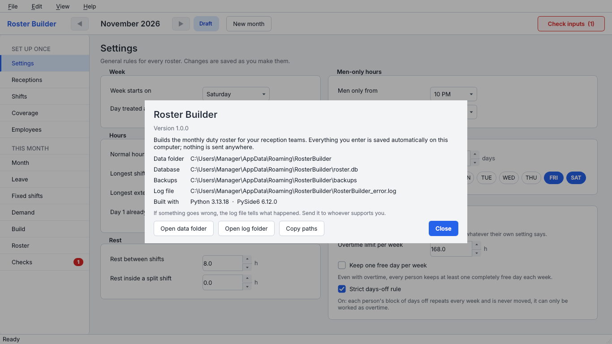

---

## 10. إذا حدث خطأ

* لا يعرض البرنامج نص أخطاء خامًا. وإذا تعذّر تشغيله أو انهار فإنه يكتب التفاصيل في **ملف السجل** `RosterBuilder_error.log` في مجلد بياناتك (`%APPDATA%\RosterBuilder`). **مساعدة ← حول** يُظهر المكان بالضبط.
* أرسل هذا الملف إلى مسؤول الدعم.
* «حمى ويندوز جهازك» (Windows protected your PC) – اختر **مزيد من المعلومات ← تشغيل على أي حال**. البرنامج غير موقّع رقميًا.
* الإنشاء يستغرق الستين ثانية كاملة والنتيجة ليست مثالية – هذا طبيعي في الأشهر الضيقة؛ ارفع المهلة الزمنية في صفحة الإنشاء أو خفّف إعدادًا مذكورًا في قائمة التعارض.
* بياناتك بأمان: أغلق البرنامج، ثم بعد إعادة فتحه استخدم **ملف ← استعادة…**، أو انسخ ملفًا من المجلد `backups` فوق `roster.db`.

---

## 11. مرجع سريع

| أريد أن… | افعل هذا |
|---|---|
| أخطّط للشهر القادم | شهر جديد ← الإجازات / المناوبات الثابتة ← فحص المدخلات ← الإنشاء ← الجدول |
| أعطي شخصًا يوم راحة في الجدول | الجدول ← انقر الخانة مرتين ← OFF |
| أجعل شخصًا يعمل عملًا إضافيًا في يوم | الجدول ← انقر الخانة مرتين ← حدّد «العمل كعمل إضافي» |
| أُبقي تعديلاتي وأنشئ من جديد | الجدول ← إعادة الإنشاء مع إبقاء تعديلاتي |
| أحصل على ملف PDF | الجدول ← تصدير PDF… |
| أتراجع | Ctrl+Z |
| أجد بياناتي | مساعدة ← حول ← فتح مجلد البيانات |
| أنتقل إلى الإنجليزية | عرض ← اللغة ← English |
| أنقل بياناتي إلى حاسوب آخر | ملف ← نسخة احتياطية الآن، انسخ الملف، ثم ملف ← استعادة… على الحاسوب الآخر |

---

## 12. لمن يُعدّ البرنامج (ويندوز)

1. ثبّت **Python 3.14** من python.org (حدّد «Add python.exe to PATH»).
2. ضع مجلد المشروع (الذي يحوي `roster_builder\`) في أي مكان، مثل `C:\roster`.
3. انقر مرتين على `roster_builder\packaging\build_exe.bat`. ينشئ مجلد `.venv` ويثبّت المتطلبات و PyInstaller ثم يبني البرنامج. ينزّل التشغيل الأول نحو 400 ميغابايت.
4. بعد ذلك يبحث عن **Inno Setup 6** (ويثبّته بواسطة winget إن لم يجده؛ وإلا نزّله من https://jrsoftware.org/isdl.php) ويصنع ملف التثبيت `dist\installer\RosterBuilder_Setup_<الإصدار>.exe`. سلّم هذا الملف الواحد للمدير. كما أن مجلد البرنامج `dist\RosterBuilder\` يعمل وحده.
5. لفحص سريع للبناء: افتح موجه الأوامر في `dist\RosterBuilder` وشغّل `RosterBuilder.exe --smoke-test`. لا يطبع شيئًا على الشاشة؛ انظر رمز الخروج بالأمر `echo %errorlevel%` (0 = سليم) – أو شغّل البرنامج ببساطة.
